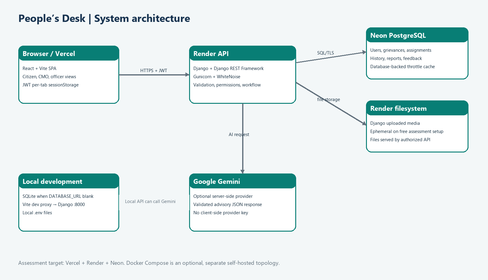

# System architecture

## Request path

The browser runs the React/Vite single-page application. It calls versioned Django REST endpoints with JSON or multipart requests. Django validates input, applies JWT authentication and role/object permissions, writes relational records, and stores files on its configured filesystem. When AI analysis is requested and a server-side Gemini key is configured, Django calls Gemini and validates the structured response.

## Components

| Component | Responsibility | Implementation |
|---|---|---|
| Web client | Public pages and citizen, CMO, officer screens | React + Vite; `frontend/src` |
| API | Auth, validation, authorization, workflow and persistence | Django + DRF; `backend/apps` |
| JWT | Access and refresh tokens; refresh rotation and blacklist | SimpleJWT; client keeps both tokens in tab-scoped `sessionStorage` |
| Database | Users, departments, grievances and audit/workflow records | SQLite locally when no `DATABASE_URL`; PostgreSQL on deployment |
| File storage | Attachments | Django filesystem storage; authorized download endpoint |
| Static files | Django admin/static assets | `collectstatic` + WhiteNoise |
| AI provider | Optional complaint analysis | Google Gemini called server-side; key never belongs in frontend config |
| Hosting | Assessment target | Vercel (frontend), Render (API), Neon (PostgreSQL) |

The repository also contains `compose.yaml` for a self-hosted Docker Compose topology. It is separate from the Render/Vercel deployment and uses PostgreSQL plus a named media volume.

## Trust and workflow boundaries

- Registration always creates a citizen; staff accounts are provisioned by an administrator.
- Citizens can access only their own grievance records. Public tracking uses the high-entropy reference and a restricted serializer.
- CMO endpoints use CMO role permissions. Officer queue, updates, reports and attachment access are scoped to the active assignment’s department.
- Assignment history records selected department, selected officer, assigning CMO, remarks and time; reassignment deactivates the old record rather than deleting it.
- Resolution requires the latest action report to be accepted and submitted by the officer on the current assignment after assignment. Reopened cases require a new report after reopening.
- Internal history and remarks are withheld from citizen serializers/tracking.
- Gemini results remain suggestions. A CMO decision is required to change official values.

## Deployment notes

Render terminates TLS and Django can trust the forwarded HTTPS protocol when `TRUST_PROXY_SSL_HEADER=True`. CORS and CSRF origins must be exact HTTPS frontend origins. The Render media path in the deployment guide is ephemeral; attachments may disappear after restart/redeploy. Render free web services can sleep while idle. Neon stores database rows separately. See [setup and deployment](06_Setup_and_Testing.md).
