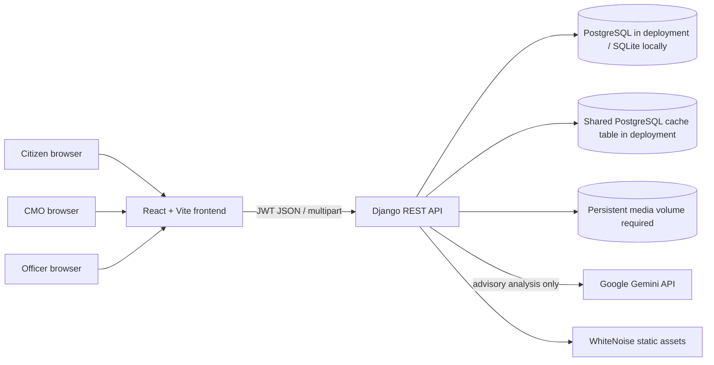

# System architecture

The browser application sends JSON or multipart requests to the Django API. The API owns authentication, role checks, status transitions, persistence, attachment authorization, throttling, and calls to Gemini. Gemini credentials remain on the server. Static admin assets are collected and served by WhiteNoise; uploaded files are served only through the authenticated attachment endpoint.

## Trust boundaries

- Public registration always creates a citizen. Elevated roles are provisioned by an operator.
- Citizen records are owner-filtered. Officer queries require an active assignment. CMO-only operations use backend role permissions.
- Public tracking is keyed by a random reference and throttled. It omits description, files, feedback, assignment details, and internal remarks.
- Uploaded files are size/extension/signature checked and downloaded only after role/object authorization.
- AI output is parsed and allowlist-validated. A signed, time-limited recommendation token is bound to the exact description when attached at grievance creation. It is not applied to official fields without an audited CMO decision.

## Deployment topology

The included Compose topology runs PostgreSQL, Django/Gunicorn, and the Nginx-served Vite SPA. The PostgreSQL named volume stores records and a shared database cache table coordinates throttling between API workers; a separate named volume persists uploads. TLS terminates at the trusted external proxy. See [deployment runbook](08_Deployment_Readiness.md) for environment, migration, cache-table, and backup steps.
