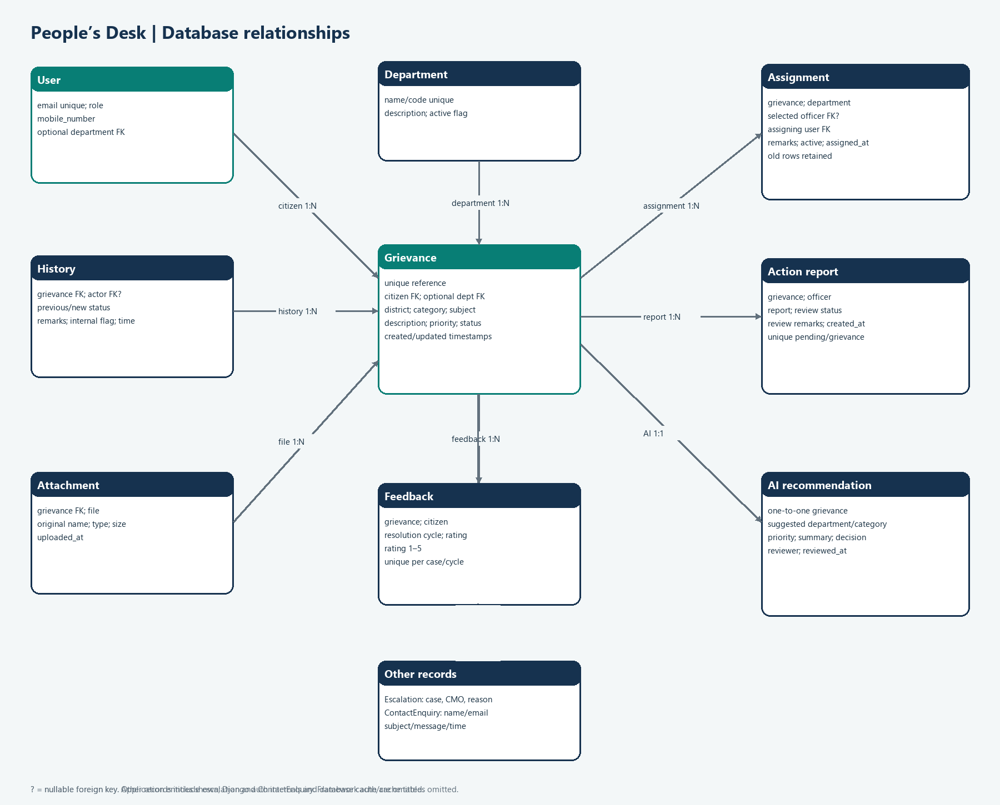

# Database design

Django models and migrations define the schema. SQLite is used locally when `DATABASE_URL` is empty; deployment requires PostgreSQL. The diagram reflects application entities (Django auth internals and framework cache tables are omitted).

## Main entities

| Entity | Important fields | Relationship and integrity rules |
|---|---|---|
| `User` | unique email, role (`CITIZEN`, `CMO`, `OFFICER`), mobile, optional department | Custom Django user; email is login identifier. Department is nullable and set null if removed. |
| `Department` | unique name/code, description, active flag | Referenced by users, grievances, assignments, and optional AI recommendations. |
| `Grievance` | unique generated reference, citizen, district, optional official department, category, subject, description, priority, status, timestamps | Citizen FK is protected. District/status/priority use model choices. Default status is `SUBMITTED`. |
| `GrievanceHistory` | grievance, previous/new status, responsible user, remarks, internal flag, time | Append-only workflow/audit entries; user can be null for system actor. |
| `DepartmentAssignment` | grievance, department, optional officer, assigning user, remarks, active flag, time | Reassignment preserves old rows and marks old assignment inactive. Officer selection is stored independently of department. |
| `ActionTakenReport` | grievance, officer, report, review status/remarks, time | At most one pending report per grievance (conditional unique constraint). |
| `Attachment` | grievance, stored file, original name, content type, size, upload time | Files stored under per-grievance randomized paths; serializer enforces allowed extension/signature and 5 MB maximum. |
| `CitizenFeedback` | grievance, citizen, resolution cycle, rating, comments, time | Rating constrained to 1–5; unique grievance + resolution cycle. |
| `AIRecommendation` | one-to-one grievance, suggested department/category/priority/summary, decision, reviewer/time | Separate from official grievance fields; department may be null if removed. |
| `GrievanceEscalation` | grievance, reason, CMO actor, time | Append-only escalation record. |
| `ContactEnquiry` | name, email, subject, message, time | Independent public contact form record. |

## Workflow integrity

Each grievance belongs to one citizen. It can have many history, assignment, attachment, report, feedback-cycle, and escalation rows. Only one assignment should be active as maintained by the assignment endpoint; old assignments remain as audit history. Resolution checks that the latest accepted report is from the current assignment’s selected officer and postdates that assignment; reopened cases also require a report after the latest reopen event.

## Schema source

Use Django migrations as the authoritative schema. Verify changes with `python manage.py makemigrations --check --dry-run`; do not edit the diagram as a substitute for a model migration.
